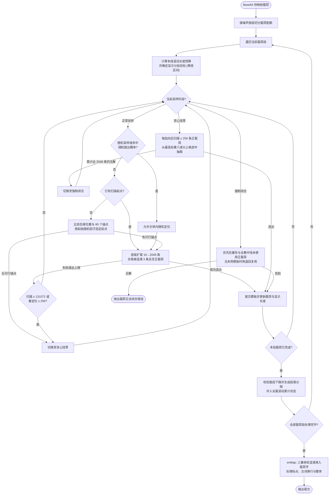
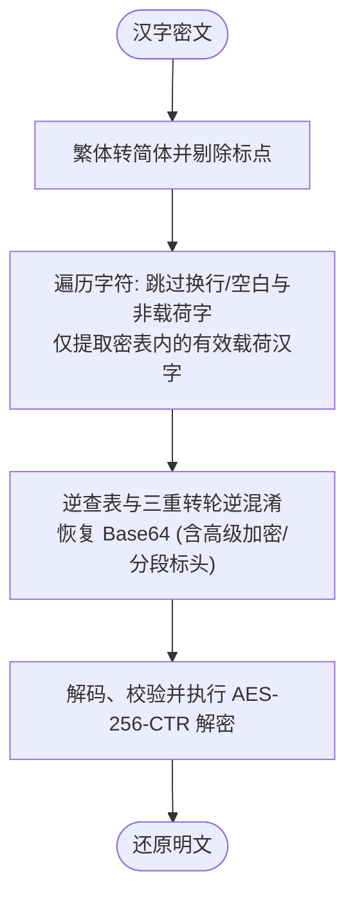

# 密文稀释

密文稀释(Dilution) 是魔曰针对统计分析防御而专门设计的文言文仿真扩展机制。

普通文言文仿真使用内置的固定句式库组织密文，有效载荷占比较高，文本较长时句式结构和字频分布容易趋于集中。启用稀释后，魔曰会从真实古文、古诗和词句式语料中按目标比例挑选模板，在保留大量非载荷文字的同时嵌入加密汉字，从而在呈现层改变密文的统计分布。

::: tip 稀释密文示例

约莫香来，倚阑低瞰庭如茶。棠阴散暑，鼎篆凝香，益日一水虚迷。几枝筇兰半烟涧，钟鼓醉中闻。绝代乐鹏，万里沈香殿。

一凉相与，片木生坚浦。只恐家肌亦自宏，二客共阑干。并蒂芙蓉本自双，草色写岩兰动住，堪伤，海上尖峰似剑芒，肠断东长遥，淡烟疏书梅时候。

:::

## 功能

在实际使用中，密文稀释提供以下几项核心能力：

- **调节载荷密度**：通过设置目标载荷率，控制承载加密数据的汉字在全文中的占比。降低载荷率会在密文周围容纳更多真实的古典文句，直接改变载荷字与非载荷字的构成比例。
- **选择古典文体**：支持指定一般古文、古诗或词来组织密文，也可以混合使用全部文体；选择古诗时，还可以进一步限定为四言、五言或七言。
- **控制段内分布形态**：提供均匀分布(`UNIFORM`)与集中分布(`CONCENTRATE`)两种模式，可以按需让有效载荷平铺于整段文本，或相对集中于段内连续区间。
- **扩展句式语料来源**：默认内置经过清洗整理的 Std 标准语料库(约十万行)，同时也支持加载外部单文件或分片语料库，为选句提供更丰富的文本范围。

::: tip 这意味着什么?

对发送方而言，稀释是在传输长度、文本风貌与统计分布之间增加的一组可调选项。降低目标载荷率后，同样一条消息通常会生成更长的古文或诗词文本。

对接收方而言，解密流程完全保持一致。接收方无需知道发送方生成时使用的载荷率、文体、分布模式或语料库，只需凭原有密钥解密完整密文即可还原明文。

:::

::: warning 局限性

稀释的防御作用发生在文本呈现层，用于改变密文的字频、句式重复和段内载荷分布，具体防御效果取决于语料规模、参数配置以及分析所依赖的统计方法，不能由目标载荷率单独推断。

消息本身的机密性仍由底层 AES-256-CTR 算法与密钥保障。若需要验证密文完整性或提高离线口令猜测成本，仍应配合启用 HMAC、PBKDF2 等高级加密套件，详见 [加密和混淆](./enc.md)。

降低目标载荷率会成倍增加输出字符数，并增加选句扫描的计算耗时。若加载自定义大型语料库，也会相应增加内存开销。

**由于此功能会显著降低密文传输效率，建议用户仅将稀释功能用于真正值得保护的个别数据**。

:::

## 配置与选择建议

初次使用时，建议保留默认的自适应采样(`SMART`)、均匀分布(`UNIFORM`)和 `0.18` 目标载荷率，先选定偏好的文体，再调整目标载荷率，观察生成长度和文本构成的变化。

- **生成格律诗词**：将文体过滤设为古诗(`POEM`)，再通过古诗字数过滤限定四言、五言或七言。若希望保留尽可能多的候选句式，将两项保持为全部(`ALL`)。
- **调节连续性与随机性**：在自适应采样模式下降低随机程度(`RandomIndex`)，可让选句更多沿用语料库中的相邻文句；若希望每轮选句都在允许文体中重新随机定位，可改用随机采样(`RANDOM`)。
- **改变段内载荷密度分布**：若希望段内不同区域的载荷密度产生明显差异，可将分布模式设为集中分布(`CONCENTRATE`)。该选项仅调整选句时的载荷位置偏好，不会将消息变成可分别解密的局部片段。

### 配置参数

在调用 `WenyanInput()` 加密时，可直接传入普通配置对象，也可通过 `new Abracadabra.DilutionConfig()` 创建配置对象，作为文言配置中的 `DilutionConfig` 传入：

- **Enable** (Boolean, 默认 `false`)：是否启用密文稀释。启用后选句由稀释语料库接管，原有的骈文(`PianwenMode`)和逻辑(`LogicMode`)开关不参与稀释选句；标点、繁体、随机因子和分段参数仍继续生效。
- **DilutionTargetRate** (Number, 默认 `0.18`)：目标载荷率，须为 [0.01, 1] 范围内最多保留两位小数的有限数值。**作用**是估算理想文本长度以控制稀释程度；**副作用**是数值越低，输出密文越长。
- **FilterMode** (String, 默认 `"ALL"`)：文体过滤模式，可选 `ALL`、`ESSAY`、`POEM`、`LYRIC`，分别对应全部可用文体、仅一般古文、仅古诗与仅词，属于整个搜索过程的硬性约束。
- **PoemFilterMode** (String, 默认 `"ALL"`)：古诗分句字数过滤，可选 `ALL`、`FOUR`、`FIVE`、`SEVEN`，仅对古诗模板生效，分别筛选每句有效分句均为四言、五言、七言的诗句，或不过滤。
- **SampleMode** (String, 默认 `"SMART"`)：采样模式，可选 `SMART` 或 `RANDOM`。前者兼顾语料连续性与预算评分，后者每轮选句均重新随机定位。
- **PayloadDistribution** (String, 默认 `"UNIFORM"`)：段内载荷分配模式，可选 `UNIFORM` 或 `CONCENTRATE`，分别为随文本进度线性分配，或偏向集中于段内的连续区间。
- **Corpus** (DilutionCorpus | null, 默认 `null`)：稀释使用的语料库容器。启用稀释且该项为空时，构造函数会自动加载内置的 Std 标准语料库。
- **PoemAutoLineBreak** (Boolean, 默认 `false`)：是否为古诗每条模板末尾自动添加单换行。不影响词模板与段落之间的双换行。
- **StyleRandomIndex** (Number, 默认 `50`)：起始位置随机因子，范围为 [0, 100]。当存在多个可用起始区域时，按该百分比概率随机挑选起点，而非固定选取预算评分最优的起点。
- **RandomIndex** (来自外层 `WenyanConfig`, Number, 默认 `50`)：随机因子，范围为 [0, 100]。启用稀释后不再影响单句长短，而是仅在 `SMART` 模式下控制每轮选句按该百分比概率主动跳出当前连续上下文并重新随机定位，推荐设置为`0`(`0` 表示尽量连续推进，`100` 表示每轮都重新随机定位，`RANDOM` 模式下固定每轮重新定位，忽略此项)。

完整字段与 TypeScript 类型定义见 [JavaScript 部署](./js-deploy.md#dilutionconfig-稀释配置)。

::: warning 参数须知

`DilutionConfig` 既支持传入普通配置对象，也支持通过 `new Abracadabra.DilutionConfig()` 创建。未提供的字段会自动补全默认值，所有参数均会执行完整校验，任意非法取值都会抛出错误。

`WenyanConfig.RandomIndex` 在密文稀释功能打开时负责控制采样的上下文连续性，默认值仍为 50，但此时未必有最佳结果。稀释时推荐设置为`0`。

目标载荷率超出 `[0.01, 1]`，以及随机因子超出 `[0, 100]` 时，构造函数都会抛出错误。

语料库 `Corpus` 若显式传入非 `null` 值，**必须**通过 `new Abracadabra.DilutionCorpus()` 初始化；直接传入普通对象作为语料库将被拒绝。

:::

::: tip 区别不同的随机指数

本项目不同功能中，有几个随机指数设置项需要特别区分。

**`RandomIndex`(普通仿真模式)**，属于外层 `WenyanConfig`，控制**组句过程中的载荷分配倾向**。数值越高，单步分配的载荷量越倾向于零碎(更易生成短句)，反之则偏好较大载荷的句式。

**`RandomIndex`(密文稀释模式)**，同为外层 `WenyanConfig`，启用稀释后不再影响单句长短，仅在 `SMART` 模式下控制**选句过程中每轮跳出上下文连续性的概率**。

**`StyleRandomIndex`(密文稀释模式)**，属于 `DilutionConfig`，仅在**需要通过锚点选定新的扫描起点时**生效，控制按多大概率从多个可行起点中随机挑选而非取平均质量最优者。

:::

## 语料库和规则集

稀释功能的语料主要分两个部分：

- **一般古文语料**：以 [**尔雅**](https://huggingface.co/datasets/RUCAIBox/Erya-dataset) 数据集收录的大量古文文本为基础。涵盖各种来源广泛，多种多样的古典文献，为稀释功能提供大量不同长度、结构和载荷密度的文言文句式。
- **诗词语料**：以 [**chinese-poetry**](https://github.com/chinese-poetry/chinese-poetry) 语料库收录的《御定全唐诗》《全宋词》等古典诗词文本为基础，一般古文语料作为补充。提供具有相对固定字数和韵律结构的诗词句式，支持独立的诗词生成模式。

原始语料经过大规模文本清洗、字符归一化、句式筛选、去重及模板化处理，最终转换为可供魔曰使用的稀释规则集。

生成的规则集按照句式类型分为古文(B)、古诗(S)和宋词(C)，每条模板均包含载荷位点、有效长度等必要信息，并进一步按照数量规模划分为不同级别(Tier)，配备相应的 Manifest 元数据，以支持运行时的随机采样、载荷率控制与句式定位。

规则集和语料库的总规模为千万级别，目前公开的规则集为 Std 级别，包含十一万行语料。

为防止滥用，更大规模的规则集和其复现代码暂不公开，语料库将不断优化更新。

| Tier          | 基础句式规模 | C 类句式 |  总句式数量 |   数据大小 |
| ------------- | -----------: | -------: | ----------: | ---------: |
| **Std**(自带) |      100,000 |   10,000 |     110,000 |   8.27 MiB |
| Plus          |      500,000 |   50,000 |     550,000 |  41.26 MiB |
| Pro           |    1,000,000 |   80,191 |   1,080,191 |  81.09 MiB |
| Supra         |    5,000,000 |   80,191 |   5,080,191 | 383.49 MiB |
| Mega          |   10,000,000 |   80,191 |  10,080,191 | 761.20 MiB |
| Ultra         |         ———— |   80,191 | ~15,000,000 |   ~1.0 GiB |

## 目标载荷率与分段机制

### 载荷率与长度预算

在魔曰的加密管线中，明文经校验、压缩、AES-256-CTR 加密及 Base64 编码后，生成待映射的 Base64 字符串。

每个 Base64 字符对应映射层中的一个**载荷位点**，最终生成一个汉字。句式中的其余汉字和标点不承载数据。

选句器首先按待映射的载荷总数和目标载荷率计算全文的理想有效长度：

```text
全文理想有效长度 = 待映射载荷总数 / 目标载荷率
```

例如，待映射的 Base64 数据共有 100 个字符时，目标载荷率设为 0.2 对应 500 字的理想有效长度，降至 0.1 则增至 1000 字。

::: tip 长度统计标准

模板有效长度包含句内标点(如逗号、顿号)，不包含末尾标点。每个载荷占位符按 1 个字符计数，其余文字按 Unicode 码点计数(避免将生僻字的代理对计为两个字符)。

此外，显示换行符与后续标点处理都会改变最终字符串长度。因此，理想有效长度并不等同于最终输出字符串的字符长度。

:::

### 滚动预算与载荷优先原则

每条模板的载荷数与有效长度均为离散整数。选句器不能为了精确凑齐比例而截断模板，也不能丢弃任何待加密数据。因此，**完成全部载荷映射是必须满足的硬性条件，目标载荷率则是尽量逼近的预算目标**。

1. **载荷层噪声分段**：选句器先使用步长为 `0.5` 的一维值噪声(`ValueNoise1D`)，在分段参数指定的区间(默认 `[20, 80]`，最大 `[20, 200]`)内将总载荷切分为若干个载荷段。
2. **段级滚动预算**：进入每一载荷段时，程序根据剩余理想长度与剩余载荷数按比例分配本段预算：

```text
本段理想有效长度 = max(0, (全文理想有效长度 - 已完成段有效长度) × 本段载荷数 / 全文剩余载荷数)
```

若前段生成得偏长，后段可用的长度预算会自动收紧，反之则适当放宽。

这种滚动补偿有助于全文平均载荷率向目标靠拢。但当长度预算耗尽时，程序仍须继续选取正载荷模板直至承载完所有数据。因此，即使将目标载荷率设为 1，最终密文也不保证全部由载荷字构成。

### 双层分段与换行控制

低载荷率会使同一份载荷对应较长的文本。为避免单个段落过长，稀释在载荷分段之外增加了一层**显示长度分段**：

- 当某载荷段的理想有效长度超过分段上限的两倍时，程序启用一个独立的一维值噪声生成器(步长 `0.5`)，在原分段区间两倍的范围内(默认 `[20, 80]` 对应 `[40, 160]` 字)滚动生成显示段落的目标长度。
- 每次提交模板后，显示计数器累加该句有效长度并加 1(计入句末标点占位)。一旦超出目标长度且本段载荷尚未耗尽，就记录一个候选切分位点，并重新抽取下一个显示段的目标长度。
- 整段载荷选句完毕后，程序自前向后检查候选切分位点：若切分后留下的尾段长度不足显示下限(分段下限的两倍)，则停止插入后续分段标记，将过短的尾段合并至前段。
- 载荷段末尾及保留的显示切分位点会插入段落分隔(输出为双换行，全篇末尾不追加)。
- 对于启用了古诗自动换行的古诗模板，在句末标点与引号闭合处理完成后会追加单个换行(已有换行时不重复添加)。

::: tip 不同的分段层次

灵活分段传输在**字节层**切分数据并独立加密；文言载荷分段在**Base64 字符层**分配段落配额；稀释显示分段仅控制**呈现文本的排版长度**。

三者分别作用于密码学封装、载荷配额与阅读呈现。显示分段和古诗换行既不会改变载荷配额，也不会创建新的独立加密分段。

关于字节级分段，详见 [灵活分段传输](./flexible.md)。

:::

## 实现机制

稀释选句在 `WenyanSimulator.selectDilutionSentence()` 中完成，随后由原有的 `enMap()` 执行三重转轮混淆、词性查表填充、标点控制与繁简转换。

具体实现见 `ChineseMappingHelper.js` 与 `ChineseDilutionHelper.js`。

### 语料结构与模板校验

`DilutionCorpus` 将语料按文体分为三个保持原顺序的模板数组：一般古文(B)、古诗(S)与词(C)。

内置 Std 语料库采用 Zstandard 压缩随库分发，在无参构造或缺少有效清单时自动解压加载。

每条模板字符串以 `/` 分隔，依次保存载荷数、有效长度、参考载荷率、文体类型与语素序列：

```text
3/14/0.21/B/N/生/富/贵/何/所/望/，/恨/不/A/嫁/东/N
```

- **载荷占位符**：支持动词(`V`)、名词(`N`)、形容词(`A`)、副词(`AD`)四种占位符，每个占位符在映射时替换为 1 个对应词性的汉字。
- **严格整数预算与校验**：选句器使用整数载荷数与有效长度计算预算，不使用已四舍五入的参考载荷率反推长度。读取模板时会重新统计占位符数与有效长度(若末位为句末标点或特殊标点标志则减 1)，并核对文体标识。任何字段校验不通过均会直接报错。
- **零载荷句式**：不含占位符的纯非载荷模板可在正常选句时补充语境，但仅在正常采样阶段、剩余长度预算严格大于该句长度，且连续零载荷句数未达上限(均匀模式上限为 128 句，集中模式上限为 128 与本段理想长度向上取整中的较大值)时才会被接受。

### 硬过滤约束

文体过滤与古诗字数过滤在整个选句与补足过程中均为**硬性过滤条件**，任何阶段都不会自动跨出允许集合：

1. **文体过滤**：按配置从一般古文、古诗、词中筛选已加载且非空的语料数组，并核对实际句式数量与元数据一致。
2. **古诗分句字数过滤**：当模板属于古诗且指定了四言、五言或七言过滤时，程序会先将载荷占位符临时替换为单字，再按句内与句末标点拆分诗句并剔除空分句，仅保留所有有效分句字数均严格符合要求的模板。不合字数要求的模板会被跳过，但本次读取仍计入扫描次数上限。

### 候选评分与分布控制

通过硬过滤的候选模板按以下规则评估预算质量并计算抽取权重：

1. **硬性排除**：载荷数超过本段剩余载荷配额的模板直接排除；零载荷模板若不满足上述接受条件也直接排除。
2. **长度预算惩罚**：
   - 当本段仍有剩余预算时，按该模板承担的载荷占比计算预期长度(`剩余长度 × 模板载荷数 / 剩余载荷数`)，以相对长度偏差的平方乘以权重系数 `4` 作为惩罚项，偏差越小质量分越高。
   - 当预算已耗尽时，转为比较单载荷字符开销(`模板长度 / 模板载荷数`)，偏好长度较短且载荷较高的紧凑模板。
   - 若该模板恰好用完本段全部剩余载荷且仍有预算，还会额外叠加与全部剩余长度之间的闭合偏差惩罚。
3. **段内分布与闭合保护**：当本段理想长度大于 `0` 时，先根据“已用长度加上当前模板长度”占本段理想长度的比例得到文本进度，再换算为期望载荷进度：
   - **均匀模式**：期望载荷进度随文本进度线性增长。
   - **集中模式**：每个载荷段随机划定一个占本段理想长度 80% 的连续区间(区间起点随机落在前 `20%` 范围内)。期望载荷主要在该区间内增长，区间外则偏向使用零载荷或低载荷模板。
   - 程序比较选后实际载荷与期望载荷的偏差，按偏差平方的指数函数对权重衰减(系数为 2)。若该模板会用完本段最后一点载荷，还会额外依据未用完的长度预算施加闭合指数衰减(系数为 4)，避免在预算仍有较大富余时过早封口而失去继续稀释的空间。
4. **质量门槛与软惩罚**：经过长度和分布评估后的分值即为候选质量，正常阶段仅接受质量不低于 `0.005` 的模板。随后叠加的两项软惩罚只调节随机抽取权重，不影响合格门槛：
   - **连续性惩罚**：在保留连续性的轮次中，若候选与上一条选中模板处于同一文体数组且下标更靠后，则按间隔句数线性降权(紧邻下一句间隔为 0 即不降权，每间隔 16 句权重约减半)。跨文体或向前方下标跳转不计距离。
   - **去重惩罚**：全文已使用过的模板，其抽取权重乘以 `0.2`。这属于软性偏好，候选不足或补足阶段仍允许复用。

### 采样模式与三阶段推进

每轮选句前，随机采样模式固定忽略连续性，先在允许文体中等概率挑选一种，再在该文体数组中随机定位.

自适应采样模式则按文言配置中的随机因子概率，决定本轮是否暂时跳出连续性。

每个载荷段内的选句状态机严格按 **正常采样 → 贪心找零 → 强制闭合** 单向推进，不回退、不重选已提交句子：

1. **正常采样**：
   - **起点选择**：需要连续性且当前无扫描起点(如段首或上轮邻域失败)时，算法将上一条选中模板的下一位置(未越界时)与最多 80 个不重复的随机位置作为候选锚点。每个锚点向后顺序扫描最多 300 条模板，统计窗口内全部合法候选的平均质量，筛选出至少含 1 条正载荷模板的可行锚点。当存在多个可行锚点时，按起始随机因子指定的百分比概率随机选取一个，否则选取平均质量最高的锚点。
   - **逐级扩窗与加权抽取**：从选定起点出发，按 `16、64、256、512、1024、2048` 条逐级扩大邻域(扩窗时只扫描新增区间)。一旦合格池不少于 3 条且已扫候选中存在正载荷模板，立即停止扩窗，按最终权重进行加权随机抽取，并把下一轮起点设在实际选中模板的下一位置。
   - **阶段切换**：单段正常阶段扫描上限为 `131072` 条(包含锚点探测)，扩窗至 `2048` 条仍未选出模板的重定位失败上限为 `256` 次。达到任一上限或无可行锚点时，转入贪心找零阶段。
2. **贪心找零**：
   - 仅接受正载荷模板，忽略连续性，每批向后扫描最多 `256` 条(到达数组末尾时切换至下一允许文体或环绕回开头)，累计最多扫描 `2048` 条。
   - 若本批找到合法正载荷候选，筛选出权重不低于本批最高值 `80%` 的候选并加权随机抽取；若耗尽 `2048` 条扫描仍无候选，转入强制闭合阶段。
3. **强制闭合**：
   - 扫描过程中，程序会维护一个最多容纳 32 条正载荷模板的兜底缓存。缓存满且尚无单载荷(P = 1)模板时，会用新遇到的单载荷模板替换最早加入的一项，以保留单位载荷闭合能力。
   - 进入强制闭合阶段后，程序优先寻找尚未使用过的正载荷模板。先在兜底缓存中按顺序查找第一条未使用且能容纳剩余载荷的模板，若未找到，则从当前游标起环绕扫描全部允许文体，选用第一条未使用且载荷不超过余量的正载荷模板。仅当允许集合内已无可用的未使用模板时，才退回复用此前记录的已用合法模板。
   - 若完整检查允许集合仍无法凑齐余量，则直接抛出错误并中止生成。

每段结束与全文结束时均会校验载荷总数，任何缺失或多分配都会立即报错。

## 流程

### 稀释选句与加密



### 解密还原



解密时，`deMap()` 只筛选属于字符映射表的载荷汉字，按原顺序执行逆混淆以恢复 Base64 数据，自动跳过所有非载荷文字、显示换行与段落分隔。

因此，接收方不需要重新运行选句算法，也不需要同步发送方的语料库或随机状态。

## 调用示例

### 基础调用

支持直接传入普通配置对象，或使用 `new Abracadabra.DilutionConfig()` 创建配置对象，通过 `WenyanInput()` 的第四个参数传入：

```js
import { Abracadabra } from "abracadabra-cn";

const Abra = new Abracadabra();
const DilutionConfigObj = new Abracadabra.DilutionConfig(
  true, // Enable: 启用稀释
  0.1, // DilutionTargetRate: 目标载荷率
  "POEM", // FilterMode: 仅使用古诗
  "FIVE", // PoemFilterMode: 仅使用五言
  "SMART", // SampleMode: 自适应采样
  "UNIFORM", // PayloadDistribution: 段内均匀分布
  null, // Corpus: 传入 null 自动加载内置 Std 语料库
  true, // PoemAutoLineBreak: 古诗每条模板后单换行
  50 // StyleRandomIndex: 起始位置随机因子
);

Abra.WenyanInput("示例内容", "ENCRYPT", "ABRACADABRA", {
  RandomIndex: 0,
  RandomParagraphing: [20, 80],
  DilutionConfig: DilutionConfigObj,
});

const CipherText = Abra.Output();

// 解密时无需传入稀释配置或语料库
Abra.WenyanInput(CipherText, "DECRYPT", "ABRACADABRA");
const PlainText = Abra.Output(); // 示例内容
```

### 加载自定义语料库

使用 `new Abracadabra.DilutionCorpus(Manifest, B, S, C)` 初始化语料库对象，并将其传给配置构造函数的第七个参数：

```js
import { Abracadabra } from "abracadabra-cn";

// ManifestJSON、BJSON、SJSON、CJSON 为调用方读取的 JSON 字符串或已解析对象。
// 不使用的文体传入 null，至少需要提供 B、S、C 中的一种。
const Corpus = new Abracadabra.DilutionCorpus(
  ManifestJSON,
  BJSON,
  SJSON,
  CJSON
);

// 分片必须按原顺序传入：第一片须含 Metadata 和 Sentences，后续片只需 Sentences。
const SplitCorpus = new Abracadabra.DilutionCorpus(
  ManifestJSON,
  [BPart1, BPart2],
  SJSON,
  null
);
```

初始化时会核对语料分级、文体类型和所有分片合计的句式总数，并严格保留原始句式顺序；清单统计中缺失的字段在运行时对象中设为 null。

::: tip 语料库回落

不传入参数调用 `new Abracadabra.DilutionCorpus()` 时，自动加载内置的 Std 语料库。

若传入的清单无效(或缺少字符串类型的分级字段)，或者三种文体均为空，同样会自动加载内置 Std 语料库。

:::
